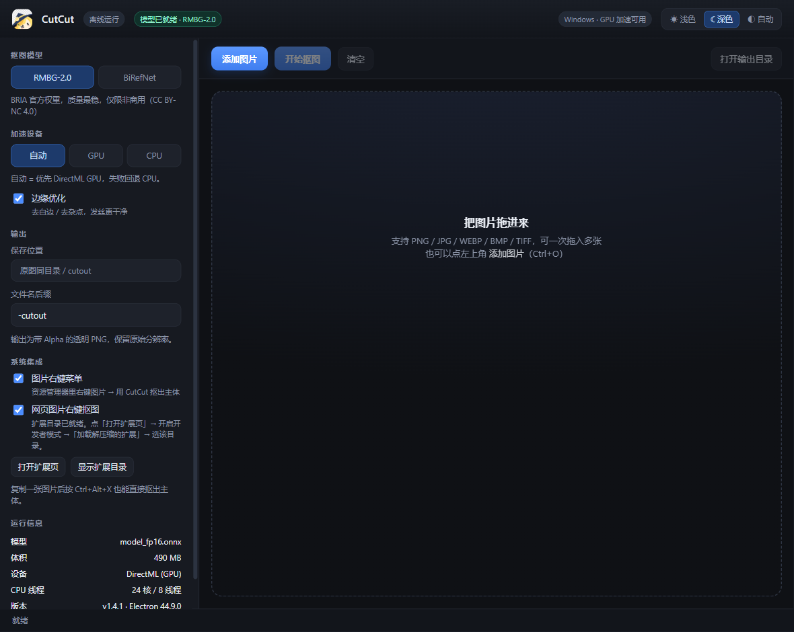
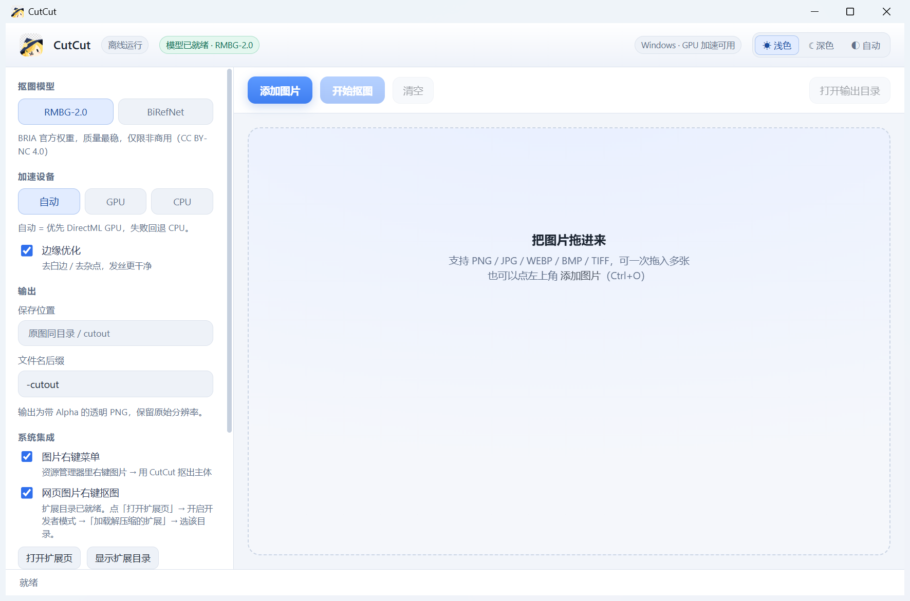
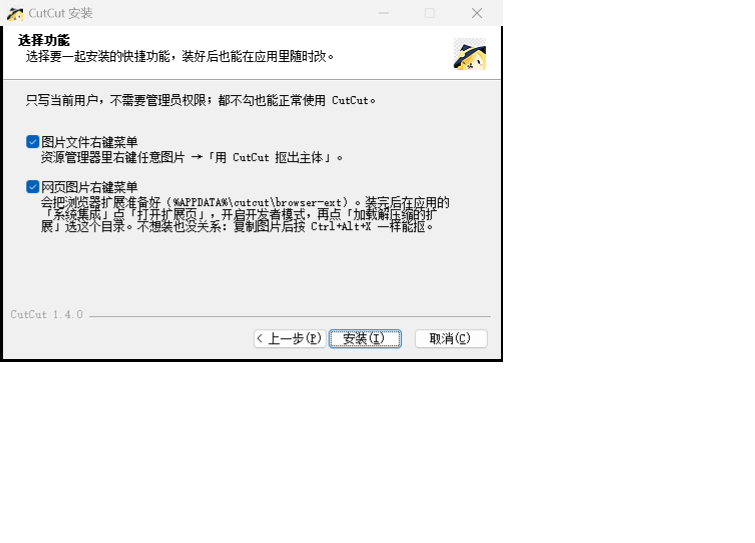

# CutCut · 一键抠图

> 本地离线 AI 抠图桌面应用。双击即用，不联网、不上传、不要 Python、不要 ComfyUI。

<p align="center">
  
</p>

**下载安装包**：[**CutCut-Setup-1.4.1.exe**](https://github.com/RaimuLimE/cutcut/releases/latest) · 123 MB · Windows 10/11 x64

---

## 这是什么

一个 Windows 桌面小工具：把图片拖进去，点一下，就得到**带透明 Alpha 的 PNG**。主体（人、猫、商品、毛绒玩具……）被抠出来，背景干净地去掉。

推理全部在本机完成。图片不会离开你的电脑，断网也能用。

<p align="center">
  
</p>

## 功能

| | |
|---|---|
| **两种模型** | RMBG-2.0（BRIA 官方权重，质量最稳，**仅限非商用**）· BiRefNet（MIT，**可商用**） |
| **GPU 加速** | DirectML，RTX 显卡上单张约 1.4 秒（RMBG） |
| **批量** | 一次拖入多张，自动排队 |
| **保留原分辨率** | 1024² 推理后双三次上采样回原图尺寸 |
| **四种入口** | 拖进窗口 · 资源管理器右键图片 · 浏览器右键网页图片 · `Ctrl+Alt+X` 抠剪贴板 |
| **深浅色主题** | 浅色 / 深色 / **自动**（07:00–19:00 浅色，其余深色） |
| **自定义安装位置** | 安装向导里可改路径，数据目录也能单独指定到别的盘 |

<p align="center">
  
</p>

## 安装

1. 从 [Releases](https://github.com/RaimuLimE/cutcut/releases/latest) 下载 `CutCut-Setup-1.4.1.exe`
2. 运行。向导会依次问：
   - **为哪位用户安装**（推荐「仅为我安装」，不需要管理员）
   - **选定安装位置** —— 想装到 D 盘就点「浏览(B)...」换路径
   - **选择功能** —— 三个可选项，默认都勾，不勾也能正常用：
     - 图片文件右键菜单
     - 网页图片右键菜单
     - **数据目录** —— 模型、设置、缓存都存这里。默认跟安装盘走
       （装在 D 盘就是 `D:\CutCut-data`），点「更改…」可另选，**不占系统盘**
3. 装完自动启动
4. **第一次用要先下载模型**（489.8 MB，约 1–2 分钟）：
   窗口左栏会出现下载面板，点「下载」。下载完自动校验 SHA-256，之后永久离线。
5. 拖图片进去 → 点「开始抠图」。结果存到**原图同目录的 `cutout\`**。

> **为什么安装包只有 123 MB，模型却要另外下？**
> RMBG-2.0 权重 490 MB、BiRefNet 928 MB。把模型打进安装包会让包体变成 1.25 GB。
> 改成「首次运行按需下载」后，安装包从 **1283 MB 压到 123 MB（−90%）**，
> 而想离线分发的用户可以直接用界面里的「从本地导入」导入 `.onnx` 文件。

<p align="center">
  
  <br>
  <em>安装向导的「选择功能」页</em>
</p>

## 网页图片右键菜单

这项**不能一键装好**，需要你手动做一次（约 30 秒）：

1. 应用左栏 →「系统集成」→ 勾选「网页图片右键抠图」
2. 点「**打开扩展页**」，浏览器会打开 `edge://extensions/`
3. 打开右上角的「**开发者模式**」
4. 点「**加载解压缩的扩展**」，选这个目录：
   `<数据目录>\browser-ext`（默认随安装盘，如 `D:\CutCut-data\browser-ext`）
   （应用里点「显示扩展目录」可以直达）

之后在任意网页上右键图片 → 「**用 CutCut 抠出主体**」。

**为什么不能自动装？** 新版 Edge/Chrome 对「注册表外置的第三方 CRX」直接屏蔽
（`ERR_BLOCKED_BY_CLIENT`）。这条路上已实测封死，所以改走官方支持的
「加载解压缩的扩展」。扩展只申请 `contextMenus` 和访问本地 `127.0.0.1` 的权限，
不读取你的浏览记录、不上传任何东西。

不想装扩展也完全没关系：**复制图片 → 按 `Ctrl+Alt+X`** 一样能抠。

## 技术栈

- **Electron 44.9.0** —— 桌面外壳
- **onnxruntime-node 1.23.2** —— ONNX 推理，DirectML / CPU 双 EP
- **sharp** —— 图像预处理（EXIF 旋转、双三次缩放）
- **NSIS**（electron-builder 26）—— 安装器，带自定义「选择功能」页

## 模型与许可

| 模型 | 来源 | 许可 | 可商用 |
|---|---|---|---|
| RMBG-2.0 | [BRIA AI](https://huggingface.co/briaai/RMBG-2.0) | CC BY-NC 4.0 | ❌ 仅非商用 |
| BiRefNet | [ZhengPeng7](https://github.com/ZhengPeng7/BiRefNet) | MIT | ✅ |

> **RMBG-2.0 本身就是 BiRefNet 微调的**——两者输出几乎逐像素一致
> （实测 MAE 0.8 / IoU 0.995）。如果要对外商用，切到 BiRefNet 即可，画质不降。

本仓库的代码（`src/`、`renderer/`、`browser-ext/`）以 **MIT** 发布。

## 从源码构建

```bash
# 需要 Node 18+（实测 Node 24 / npm 11）
npm install

# 图标 + 浏览器扩展 的资源生成
node scripts/make-icon.cjs
node scripts/make-ext-icons.cjs
node scripts/make-crx.cjs

# 打包（产物在 dist/）
npx electron-builder --win nsis --x64
```

Windows 上建议先 `set ELECTRON_MIRROR=https://npmmirror.com/mirrors/electron/`，
否则 Electron 二进制下载可能很慢。

开发时直接跑：

```bash
npx electron .
```

**注意**：`npm install` 后 Electron 的 dist 可能没下下来（npm 默认拦 install scripts），
需要手动 `node node_modules/electron/install.js`。

## 目录结构

```
cutcut/
├─ src/
│  ├─ main.js          # 主进程：窗口、IPC、单实例 + --cutout 命令行、全局热键
│  ├─ preload.js       # contextBridge（window.api）
│  ├─ segment.js       # 推理核心：模型注册表、ONNX 会话、预处理、mask 上采样
│  ├─ models.js        # 模型分发层：清单、断点续传下载、SHA-256 校验、本地导入
│  ├─ bridge.js        # 本地 HTTP 桥（127.0.0.1:8770-8779），给浏览器扩展调
│  ├─ integrations.js  # 注册表右键菜单、扩展目录部署、浏览器探测
│  └─ refine.js        # 边缘细化（去白边/去杂点）
├─ renderer/
│  └─ index.html       # 单文件 UI（双主题、拖拽、卡片网格、进度）
├─ browser-ext/        # MV3 扩展：网页图片右键 → POST 到本地桥
├─ build/
│  ├─ icon-source.svg  # 图标源（矢量）
│  ├─ icon.ico / icon.png
│  ├─ installer.nsh    # NSIS 自定义页（「选择功能」）+ 注册表写入
│  └─ browser-ext.crx  # 打包好的扩展（备用）
├─ scripts/            # 开发/验证脚本（构建、探针、CDP 验证）
└─ docs/screenshots/
```

## 已知限制

- **仅 Windows x64**。DirectML 只在 Windows 上可用；macOS/Linux 需要改 EP 配置。
- **BiRefNet 在 DirectML 上必崩**（`DmlFusedNode` 报错），所以 BiRefNet 强制走 CPU，
  单张约 19–25 秒。这是 ONNX Runtime 1.23/1.30 都存在的上游问题。
- **onnxruntime-node 必须锁 1.23.2**。1.30 对 BiRefNet 在 DirectML 上同样失败。
- 抠图 mask 是 1024² 推理后双三次放大的，**极细发丝会略糊**。这是 RMBG/BiRefNet
  这类模型的固有分辨率限制，不是实现问题。

## 更新日志

### v1.4.1 (2026-10-22)
- 新增：安装向导可选**数据目录**（模型 / 设置 / 缓存都放这里，不占系统盘）
- 新增：老用户首次启动时自动把旧数据复制到新数据目录（只复制不移动，安全）
- 修复：卸载时保留数据目录（模型不用重新下载），只清理扩展目录

### v1.4.0 (2026-10-21)
- 新增：资源管理器图片右键菜单（`--cutout` 命令行入口 + 单实例转交）
- 新增：浏览器扩展，网页图片右键直接抠（本地 HTTP 桥）
- 新增：`Ctrl+Alt+X` 抠剪贴板图片
- 新增：安装器「选择功能」页，两个可选项
- 修复：Electron 44 移除了 `clipboard.readImage()`，改用异步 Web 标准 API
- 修复：侧栏长路径导致的横向溢出

### v1.3.0 (2026-10-21)
- **安装包 1283 MB → 123 MB**：模型改为首次运行时按需下载（断点续传 + SHA-256 校验 + 本地导入）
- 新增模型下载/导入/移除的完整 UI

### v1.2.1 (2026-10-20)
- 新增浅色主题 + 深浅色切换 + 按时间自动切换
- 安装器支持自定义安装位置
- 图标水平镜像（避开快捷方式角标）

### v1.1.0 (2026-10-20)
- 集成 BiRefNet（MIT 可商用）
- 移除「调用本机 ComfyUI」后端，改为纯本地 ONNX
- 更名 RMBG 一键抠图 → **CutCut**，换新图标

### v1.0.0 (2026-10-20)
- 首个版本：ONNX Runtime + DirectML 本地抠图

## 致谢

- [BRIA AI](https://www.bria.ai/) —— RMBG-2.0 权重
- [ZhengPeng7](https://github.com/ZhengPeng7/BiRefNet) —— BiRefNet 架构与权重
- [microsoft/onnxruntime](https://github.com/microsoft/onnxruntime) —— 推理引擎与 DirectML EP
- [electron](https://www.electronjs.org/) / [electron-builder](https://www.electron.build/) / [sharp](https://sharp.pixelplumbing.com/)
