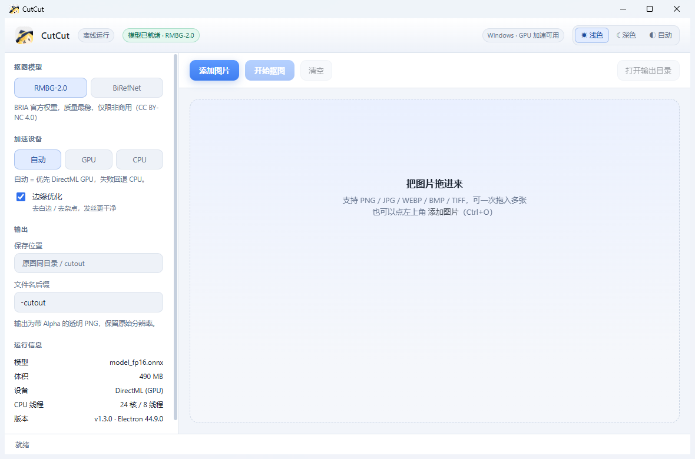
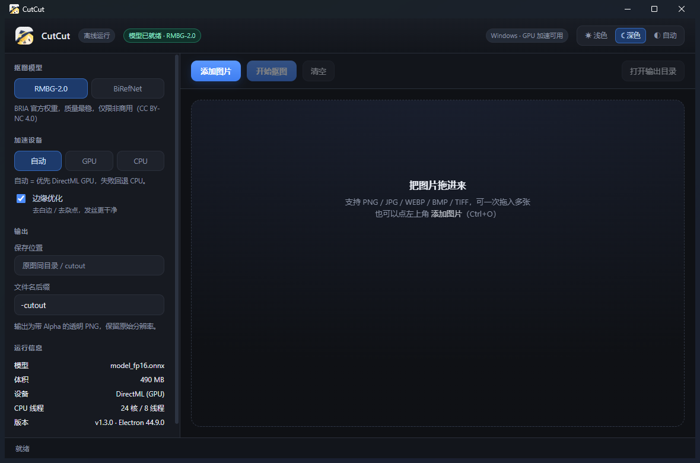

# CutCut · 一键抠图

把「RMBG-2.0 / BiRefNet 抠图」做成**双击安装、离线可用**的 Windows 桌面应用。
不需要 Python，不需要 ComfyUI，不需要显卡驱动之外的任何东西。



---

## 一、给最终用户：怎么用

1. 双击 `CutCut-Setup-1.4.1.exe`（**123 MB** 左右，安装后占 400 MB）
2. 安装向导会问「为哪位用户安装」和「**选定安装位置**」——
   想装到 D 盘就点「浏览(B)...」换路径，默认在 `%LOCALAPPDATA%\Programs\CutCut`
3. 接下来是「**选择功能**」页，三个可选项（默认都勾，不勾也能正常用）：
   - **图片文件右键菜单** —— 资源管理器里右键任意图片 → 「用 CutCut 抠出主体」，直接开抠
   - **网页图片右键菜单** —— 浏览器里右键网页上的图片 → 「用 CutCut 抠出主体」
   - **数据目录** —— 模型、设置、缓存全存这里。默认跟着安装盘走
     （装在 D 盘就是 `D:\CutCut-data`），点「更改…」可以另选，**完全不占系统盘**
4. 装完自动启动，桌面和开始菜单会有「CutCut」快捷方式
5. **第一次用，先下载模型**：窗口左栏会出现下载面板，点「下载（489.8 MB）」
   （实测 5–7 MB/s，约 75–90 秒；下完自动校验 SHA-256，之后永久离线）
6. 把图片拖进窗口 → 点「开始抠图」
7. 结果自动存到 **原图同目录的 `cutout\` 文件夹**

- 支持 PNG / JPG / WEBP / BMP / TIFF / GIF，可一次拖入多张
- 输出为**带 Alpha 的透明 PNG**，保留原始分辨率
- 除首次下载模型外**全程离线**，不联网、不上传

> 首次处理第一张图有 10~20 秒模型加载（一次性），之后 RMBG 每张约 **1~2 秒**。

### 四种抠图入口

装好之后，抠同一张图有四个入口，效果完全一样：

| 场景 | 操作 |
|---|---|
| 本地图片文件 | 资源管理器右键 → **用 CutCut 抠出主体**（装的时候勾了才生效） |
| 网页上的图片 | 浏览器右键图片 → **用 CutCut 抠出主体**（需在扩展页加载一次扩展，见下） |
| 复制的图片 | 任意时候按 **Ctrl+Alt+X**，直接抠剪贴板里的图（截图、微信图片都行） |
| 应用窗口 | 拖进去 / Ctrl+O 选文件 |

**网页图片右键菜单怎么启用**（只需一次）：应用左栏「系统集成」勾上「网页图片右键抠图」
→ 点下面的「打开扩展页」→ 在浏览器里打开「开发者模式」→ 点「加载解压缩的扩展」
→ 选 `<数据目录>\browser-ext`（默认 `D:\CutCut-data\browser-ext`） 这个目录。

> 为什么不能一键装好？新版 Edge/Chrome 会直接屏蔽注册表外置的第三方 CRX
> （打开扩展页地址报 `ERR_BLOCKED_BY_CLIENT`），只剩「开发者模式 + 加载解压缩的扩展」
> 这条官方允许的路。扩展本身没问题——它用的就是浏览器标准的 `contextMenus` API，
> 只请求了本地 `127.0.0.1` 和取图片字节所必需的权限。

### 模型为什么不随包分发

1.2.x 把两个模型（1.4 GB）直接打进安装包，安装包 1.25 GB。
1.3.0 起改成**模型外置、首次运行下载**，安装包降到 **123 MB**（1.4.x 保持此体积）：

| | 1.2.1 | 1.3.0 / 1.4.x |
|---|---|---|
| 安装包 | 1283 MB | **123 MB** |
| 安装后占用 | 1866 MB | 400 MB + 模型 |
| 首次使用 | 装完即用 | 需下载 490 / 928 MB 模型 |
| 之后 | 离线 | 离线 |

下载走 ModelScope / hf-mirror 国内源，实测 5–7 MB/s，RMBG 约 75–90 秒。
支持**断点续传**（关掉应用下次接着下）和**从本地导入**（`从本地导入` 按钮，
可选已有的 `.onnx` 文件，格式对就能用）。


### 外观：深色 / 浅色 / 自动

右上角三个按钮切换：**☀ 浅色** / **☾ 深色** / **◐ 自动**。

- 选「自动」时，**07:00–19:00 用浅色，其余时间用深色**，每 30 秒对一次表，跨过时间点会自动换肤
- 快捷键 **Ctrl+Shift+L** 直接对调深浅
- 选择会记住，下次启动直接生效（连启动瞬间的背景色都跟着变，不会闪一下）

| 深色 | 浅色 |
|---|---|
|  |  |

### 两个模型怎么选

左栏「抠图模型」可切换，两个都装在应用里，随时切：

| 模型 | 授权 | 速度（本地实测） | 适用 |
|---|---|---|---|
| **RMBG-2.0** | CC BY-NC 4.0 · **仅非商用** | 快，约 1~2 秒/张（GPU） | 个人使用、质量首选 |
| **BiRefNet** | **MIT · 可商用** | 慢，约 20~40 秒/张（CPU） | 商用、可自由分发 |

实测两者蒙版几乎重合（MAE 0.8 / IoU 0.995），画质没有可感知差别。
所以：**个人用选 RMBG，要商用选 BiRefNet**。

---

## 二、技术方案（为什么不是「打包 DSH + ComfyUI」）

原始需求是「把调本机 ComfyUI 的那个预设封装成独立应用」。评估后放弃了这条路：

| 方案 | 体积 | 依赖 | 结论 |
|---|---|---|---|
| A. 重打包 DSH Electron + 固化预设 | 14 GB+ | 每台机器仍要装 Python + PyTorch + ComfyUI + CUDA | ✗ 完全不「傻瓜」 |
| B. 内置 ComfyUI 全家桶 | 20 GB+ | 要带整套 Python 环境和 CUDA | ✗ 装不动 |
| **C. 直连 ONNX 推理（本方案）** | **123 MB** | **零外部依赖** | **✓ 采用** |

关键洞察：**ComfyUI 只是个壳**。真正的抠图逻辑就是 BiRefNet 前向推理，
早已被导出成 ONNX。用 `onnxruntime-node` 直接跑，就绕开了 Python、
绕开了 ComfyUI、绕开了 14 GB 的运行时。

### 推理链路

```
图片 → sharp 解码（尊重 EXIF 旋转）
     → resize 1024×1024 → ImageNet 归一化 → NCHW float32
     → onnxruntime (DirectML GPU 或 CPU)
     → mask [1,1,1024,1024]
     → 双三次插值回原尺寸
     → 边缘后处理（对比度拉伸 + 去小块 + 去色溢）
     → RGBA PNG
```

两个模型只在 IO 契约上有差别，`segment.js` 用一张注册表吸收掉：

| | 输入 | 输出 | 后处理 | GPU |
|---|---|---|---|---|
| RMBG-2.0 | `pixel_values` | `alphas` | 已是 sigmoid 概率，直接用 | ✓ DirectML |
| BiRefNet | `input_image` | `output_image` | **是 logits，需手动 sigmoid** | ✗ 强制 CPU |

### 四个入口怎么汇到同一条管线（1.4.0）

不管图从哪来，最后都是「一个磁盘路径 → `deliverPaths()` → 渲染进程 `addPaths()` → 同一个 `runQueue()`」：

| 入口 | 机制 |
|---|---|
| 拖进窗口 / Ctrl+O | 渲染进程 `webUtils.getPathForFile()` 拿路径 |
| **资源管理器右键** | 注册表 `shell\CutCut\command` = `CutCut.exe --cutout "%1"`；新进程被 `requestSingleInstanceLock()` 挡下，`second-instance` 事件里解析 `--cutout` 参数转交第一实例 |
| **网页图片右键** | 扩展 `contextMenus[image]` → `fetch` 图片字节 → `POST http://127.0.0.1:8770/cutout` → `bridge.js` 落盘到 temp → `onImage` 回调 |
| **Ctrl+Alt+X** | `globalShortcut` → 读剪贴板位图或文件列表 → 落盘 temp |

`deliverPaths()` 的两个时序坑：渲染进程 `init()` 里有若干 `await`（读设置、`app:info`），
`did-finish-load` 时它**还没挂上** `onOpenFiles` 监听，早发的图会静默丢掉。
所以改成渲染进程主动报到（`preload.js` 的 `ready()` → `ipcMain.on('app:ready')` → `flushPending()`），
`did-finish-load` 只留 3 秒兜底。

`bridge.js` 的鉴权：`Origin` 必须是 `chrome-extension://` / `edge-extension://` 之一（否则 403），
且必须带 `X-CutCut: 1`（否则 400）——防的是任意网页往 `127.0.0.1` 打 POST。
端口从 8770 往上试 10 个，选中的端口写到 `<tmp>\cutcut-bridge\port.txt` 供排查。

---

> 完整的选型决策、实测数据与踩坑记录见 **[PROJECT-REPORT.md](PROJECT-REPORT.md)**。

---

## 三、开发者：目录结构与构建

```
cutcut/
├─ src/
│  ├─ main.js          主进程：窗口、IPC、设置、文件对话框、自检、单实例/--cutout、数据目录
│  ├─ preload.js       contextBridge 暴露 window.api
│  ├─ models.js        模型分发层：清单 / 下载 / 续传 / SHA-256 校验 / 导入
│  ├─ segment.js       ONNX 推理核心 + 模型注册表
│  ├─ refine.js        蒙版后处理（去白边 / 去杂点）
│  ├─ bridge.js        本地 HTTP 桥（127.0.0.1:8770–8779），收浏览器扩展发来的图
│  └─ integrations.js  HKCU 右键菜单注册 + 扩展目录安装/检测
├─ browser-ext/        浏览器扩展源码（MV3，contextMenus）
├─ renderer/index.html 单文件 UI（无框架，双主题 + 模型下载面板 + 系统集成）
├─ build/              icon-source.svg / icon.png / icon.ico / installer.nsh
├─ scripts/            图标生成、crx 打包、模型对比、冒烟测试、CDP 验收
├─ docs/               详细文档、截图、项目报告
└─ package.json        electron-builder 配置
```

### 构建

```bat
cd <仓库根>
npm install
npm run icons
npx electron-builder --win nsis --x64
```

或逐步：

```bat
npm install
node node_modules\electron\install.js          :: npm 默认拦截 install script
node scripts\make-icon.cjs                     :: SVG → 各尺寸 icon.ico
node scripts\make-ext-icons.cjs                :: 扩展的 16/32/48/128 图标
node scripts\make-crx.cjs                      :: 打包浏览器扩展（写 CRX3 + manifest.key）
node scripts\check-catalog.cjs                 :: 校验清单里的体积/SHA-256
node node_modules\electron-builder\cli.js --win nsis --x64
```

产物：`dist\CutCut-Setup-1.4.1.exe`（约 123 MB）

> `build/ext-key.pem` 是扩展私钥，**不随仓库分发**（已在 `.gitignore` 里）。
> 没有它 `make-crx.cjs` 会重新生成一对，扩展 ID 随之改变。这对普通构建没有影响——
> 扩展是「加载解压缩的扩展」方式安装的，ID 变了重新加载一次即可。
> `scripts/_crxparse.cjs <crx>` 可回读校验 CRX3 结构与签名。

> **`check-catalog.cjs` 不能省**。它比对 `models.js` 里写死的 bytes/sha256 与
> `../models/` 实际文件是否一致。清单写错时本地开发完全正常（模型在本地），
> 但**所有用户下载完都会校验失败**——这是唯一能在打包前拦住它的检查。
> 没有 `models/` 时它会跳过并成功退出，不影响没下模型的人打包。


> `build.cmd` 必须是 **CRLF** 换行。若被编辑成 LF，`cmd /c build.cmd` 会报一串
> `'...' is not recognized as an internal or external command` 并 exit 1。

### 安装器配置

`package.json` 的 `build.nsis`（1.4.0 现用值）：

```json
{
  "oneClick": false,
  "allowToChangeInstallationDirectory": true,
  "perMachine": false,
  "allowElevation": true,
  "installerLanguages": ["zh_CN"],
  "language": "2052",
  "createDesktopShortcut": "always",
  "createStartMenuShortcut": true,
  "shortcutName": "CutCut",
  "runAfterFinish": true
}
```

`oneClick: false` + `allowToChangeInstallationDirectory: true` 才会出现「选定安装位置」页，
也就是用 NSIS 内置的 `MUI_PAGE_DIRECTORY`。少任何一个都会变成一键装到默认路径。

### 安装器的「选择功能」页（1.4.0 起，1.4.1 加了数据目录）

可选页不是 electron-builder 的原生选项，是自己写的 `app/build/installer.nsh`：

- `!macro customPageAfterChangeDir` → 在「选定安装位置」之后、开始安装之前插入一页
  `Page custom ccOptionsPageCreate ccOptionsPageLeave`（`nsDialogs.nsh` 手绘两个 checkbox
  + 一个可改的「数据目录」标签和一个「更改…」按钮）
- `!macro customInstall` → 文件都解压完之后执行：勾了「图片右键菜单」就写 HKCU 的
  `Software\Classes\SystemFileAssociations\image\shell\CutCut`；勾了「网页图片右键」就把
  `browser-ext\` 整个目录铺到 `$CC_DataDir\browser-ext`；无论勾不勾都把
  `$CC_DataDir` 写进 `$INSTDIR\data-dir.txt`，主进程启动时读它并 `app.setPath('userData', ...)`
- `!macro customUnInstall` → 删菜单键 + 删 `<数据目录>\browser-ext`，
  **数据目录本身保留**（模型 490 MB，删了要重下）

数据目录默认值由 `Function ccComputeDataDir` 算：`StrCpy $0 "$INSTDIR" 2` 取盘符，
再看第 3 个字符是不是 `:`，是就 `$0\CutCut-data`；拿不到盘符时回落到 `$APPDATA\cutcut`。

三个必须记住的坑：

1. **所有可选页相关代码必须包在 `!ifndef BUILD_UNINSTALLER` 里**。electron-builder 编译安装器
   和卸载器是两遍，`assistedInstaller.nsh` 的 `!else` 分支（卸载器那遍）不引用自定义页，
   NSIS 会报 `warning 6010: install function "ccOptionsPageCreate" not referenced`，
   而 electron-builder 把 warning 当 error —— 打包直接失败。`Var` 声明也要一起放进去，
   否则接着报 `warning 6001: Variable "CC_OptMenu" not referenced or never set`。
   **但 `customInstall` / `customUnInstall` 两个宏必须留在 `!ifndef` 外面**（卸载器也要用）。
2. **复制扩展目录不能用 `CopyFiles`**——它不递归，`icons\` 子目录会漏，浏览器随后报「扩展已损坏」。
   要用 `SetOutPath` + `File /r` 在编译期把文件嵌进安装包。
3. **静默安装 `/S` 不走可选页**，变量是空的，所以 `customInstall` 开头要判断
   `${If} $CC_OptMenu == ""` → `StrCpy $CC_OptMenu ${BST_CHECKED}`（默认都装）；
   数据目录同理 `$CC_DataDir == ""` 时先 `Call ccComputeDataDir`。

4. **卸载器里不能用 `${WordFind}`**。`WordFunc.nsh` 只定义 `!define WordFind`，没有
   `un.WordFind`，会报 `Invalid command: "${WordFind}"`。剥 `FileRead` 回来的行尾改成手工
   `StrCpy`（取最后一个字符判断 `$\r` / `$\n` 再 `StrCpy ... -1`）。

5. **静默安装 `/D=` 必须显式带到目录名**。`/D=D:\` 会让 electron-builder 的
   `${StrContains} $0 "${APP_FILENAME}" $INSTDIR` 判断失败，把 400 MB 全倒进 D 盘根目录；
   正确写法是 `/D=D:\CutCut`（最终仍会多一层，装成 `D:\CutCut\`）。

### 数据目录（1.4.1）

安装器和主进程之间靠**一个文本文件**约定数据位置，不需要改注册表：

```
<安装目录>\data-dir.txt     ← 内容就是数据目录的绝对路径（如 D:\CutCut-data）
```

主进程在 `src/main.js` 顶部（`app.whenReady` 之前）就把它读出来：

```js
const dataChoice = resolveDataDir()          // CUTCUT_DATA 环境变量 > data-dir.txt > 默认
const legacyUserData = app.getPath('userData')   // 先记住旧位置
if (dataChoice.dir && path.resolve(dataChoice.dir) !== path.resolve(legacyUserData)) {
  fs.mkdirSync(dataChoice.dir, { recursive: true })
  app.setPath('userData', dataChoice.dir)    // 设置 + 模型 + Chromium 缓存全搬过去
}
```

**顺序是关键**：这段必须早于任何 `app.getPath('userData')` 调用。那些调用都在函数体内
（`modelCandidates` / `availableModels` / `settingsPath`），是延迟执行的，所以放在文件顶部即可。

老用户升级时，`migrateLegacyData()` 会把旧目录的 `settings.json` 和 `models/` **复制**
（不是移动）到新数据目录，然后写 `<新目录>\.migrated-from-legacy` 标记，第二次启动不再复制。
用复制是为了就算中途断电也不会两头都缺文件。

排查手段：
- 界面「运行信息」里的 `userData`（`window.api.info()` 返回）就是实际数据目录
- `CUTCUT_DATA=D:\some\dir` 可以临时覆盖，方便测试
- 卸载**不会删数据目录**（模型 490 MB，删了用户要重下），只删 `<数据目录>\browser-ext`

### 换模型 / 加模型

1.3 起模型不在包里，所以「换模型」= 改 `app/src/models.js` 的 `CATALOG`，不动打包配置：

```js
// 加一个可下载的模型
myModel: {
  file: 'my.onnx',
  bytes: 123456789,
  sha256: '...',                       // 必须和下载源一致，否则校验失败
  sources: [{ url: 'https://.../my.onnx', referer: 'https://...' }],
},
```

`bytes` / `sha256` 用 `scripts/check-catalog.cjs` 对着本地真实文件核对。
`sources` 是**有序回退列表**，前一个域名挂了会自动试下一个。

「禁用某个模型」只需把它从 `segment.js` 的 `MODELS` 注册表里删掉，UI 会自动少一个按钮。

运行时也支持外挂：把 `.onnx` 放到

```
<数据目录>\models\
```

（1.4.1 起数据目录由安装器写在 `<安装目录>\data-dir.txt`，默认 `<安装盘>:\CutCut-data`；
开发态没这个文件时才回落到 `%APPDATA%\cutcut`，目录名取 `package.json` 的 `name`，是**小写**。
以 `window.api.info()` 返回的 `userData` 为准。）
这是模型的**首选**位置（先于安装目录），所以用户不用重装就能换模型，
「从本地导入」按钮也是把文件复制到这里。


---

## 四、踩过的坑（改代码前先看）

1. **`ELECTRON_RUN_AS_NODE=1`**
   本机环境有这个变量时 `electron.exe` 会退化成纯 Node，
   `require('electron').app` 为 `undefined`，报
   `Cannot read properties of undefined (reading 'commandLine')`。
   跑任何 Electron 前先 `Remove-Item Env:ELECTRON_RUN_AS_NODE`。

2. **npm 拦截 install scripts**
   `npm install` 后 `electron/dist/` 是空的。要手动跑
   `node node_modules/electron/install.js`，并设
   `ELECTRON_MIRROR=https://npmmirror.com/mirrors/electron/`。

3. **NSIS 只认 `.ico`**
   传 `icon.png` 会报 `invalid icon file` + `MUI_INTERFACE macroline 87`。
   `scripts/make-icon.cjs` 直接从 SVG 按 density 逐尺寸渲染再手工拼 ICO 容器，
   比「大图缩一份」清晰得多（16px 仍有 115 种颜色）。

   > v1.2.1 起默认对图标做**水平镜像**（`sharp().flop()`）。原方向的眼睛在左下，
   > 会被桌面快捷方式的箭头角标压住；镜像后眼睛移到右侧，角标区域是干净的帽檐。
   > 设 `ICON_FLOP=0` 可还原原方向。`scripts/mock-shortcut.cjs` 会模拟角标叠加效果。

4. **两个模型的输出语义不同**
   RMBG 的 `alphas` **已经过 sigmoid**；BiRefNet 的 `output_image` 是 **logits**
   （实测 min=-19.2 max=-10.9），必须手动 sigmoid。搞混就是全黑或全白。

5. **`graphOptimizationLevel: 'all'` 会让 fp16 模型加载失败**
   报 `Attempting to get index by a name which does not exist:
   InsertedPrecisionFreeCast_/model/bb/patch_embed/norm/...`。必须用 `'extended'`。

6. **BiRefNet 在 DirectML 上必崩**
   `Non-zero status code returned while running DmlFusedNode_15_51`。
   换了 basic / disabled / 关内存复用 / 顺序执行四种配置、以及
   ORT 1.30（原 1.23.2）全都失败于同一个 fused node。
   **结论：BiRefNet 只能走 CPU**，所以 `MODELS.birefnet.dml = false`，
   `providerCandidates()` 会据此过滤掉 DML，避免用户选「GPU」时白等一次崩溃。

7. **sharp 把单通道升成三通道**
   `mask` Buffer 调 `.resize()` 后会变成 3 通道，按字节直接读会整幅错位。
   要用 `toBuffer({resolveWithObject:true})` 读 `info.channels` 再按 stride 跨步取。

8. **`extraResources.from` 是相对 `app/` 的**
   写成 `../../models/...` 会静默失败（只打印 `file source doesn't exist`），
   打出来的包里没有模型，运行时才报「未找到模型」。正确写法是 `../models/...`。

9. **拖拽拿真实路径必须用 `webUtils.getPathForFile`**
   Electron 32+ 移除了 `File.path`。

10. **CSP 会挡掉本地图标**
    `img-src data: blob:` 会让 `` 被拦，
    界面左上角变成空方块。表达式里要带 `'self' file:`。

11. **HF 直连被墙**
   `huggingface.co` 连不上；用 `hf-mirror.com`，且必须带
   `User-Agent: Mozilla/5.0`。ModelScope 的下载要额外带
   `Referer: https://modelscope.cn/`，否则 403。

12. **做浅色主题必须先把颜色变量化**
    原版 UI 把大量颜色直接写在规则里（`linear-gradient(180deg,#191d25,#12151b)`、
    `.badge.ok` 的 `#8ff0cc/#1f6e57/#10312a`……），只改 `:root` 的几个变量是无效的。
    现在全部收敛成 35 个 CSS 变量，新增主题只需再写一组 `:root[data-theme="x"]`。

13. **主题切换会闪一下**
    渲染进程读到设置之前是默认配色。解决：`<head>` 最前面内联脚本读
    `localStorage['cc.theme.effective']` 直接写 `documentElement.dataset.theme`；
    主进程 `createWindow()` 也按当前时段算 `backgroundColor`。

14. **`PrintWindow` 抓窗口图要两个前提**
    `PrintWindow(h, hdc, 2)` 的 **2 = PW_RENDERFULLCONTENT**，否则 GPU 合成的页面是黑屏；
    并且进程必须先 `SetProcessDpiAwarenessContext(-4)`（PER_MONITOR_AWARE_V2），
    否则 150% 缩放下 `GetWindowRect` 返回虚拟像素、`PrintWindow` 渲染物理像素，整幅图右下被裁。
    另外窗口最小化时 rect 是哨兵值 `(-21333,-21333)`，要先 `ShowWindow(h, 9)` 恢复。

15. **`mdBusy` 的 TDZ 会把整个初始化打断**
    1.3.0 第一次打包后，界面看起来正常但下载面板不出现、按钮全灰。
    `#modelDown` 一直 `display:none`，页脚写着
    `初始化失败：Cannot access 'mdBusy' before initialization`。
    原因：`syncModelUI()` 里读 `mdBusy`，而 `const mdBusy = { id: null }`
    被写在了第一次 `syncModelUI(cur.id)` 之后 —— `const` 有暂时性死区。
    `init()` 中任何异常都只落到 `setStatus()`（页脚一行小字），
    所以**报错不明显、界面看起来「只是没数据」**。
    排查这类「界面半死」问题最快的办法是 CDP 读页脚文本 + 检查
    `typeof $('#btnAdd').onclick`：事件没绑上就说明 init 中途抛了。

16. **`D:\DeepSeekHarness\userspace` 这棵树里的 Electron 会崩溃**
    同样一个 `win-unpacked`，放在 `D:\cc13` 跑正常，放在
    `D:\DeepSeekHarness\userspace\...` 下就 `EXCEPTION_BREAKPOINT`（exit `-2147483645`），
    连 `electron.exe --version` 都无输出。该目录带一条
    `Everyone:(CI)(DENY)(DC)` 的 ACL 和 `Low Mandatory Level:(OI)(CI)(NW)` 完整性标签，
    Electron 子进程（GPU/renderer）在这类受限令牌下起不来。
    **验证打包产物时一定要复制到 `userspace` 之外**（例如 `D:\cc13`）再跑，
    否则会把「环境问题」误判成「代码问题」。
    **`node_modules` 也不能用 junction 指回去** —— 一样崩，必须 `robocopy /E` 物理复制。

17. **Electron 44 删掉了 `clipboard.readImage()`**
    实测 `clipboard` 只剩 `clear/has/readText/read/write`；`readImage`、`readBuffer`、
    `availableFormats` 全是 `undefined`，直接调用抛
    `clipboard.readImage is not a function`。新 API 是 Web 标准形状且**全异步**：
    ```js
    const items = await clipboard.read('image/png')   // ClipboardItem[]
    const blob  = await items[0].getType('image/png') // 也是 Promise<Blob>
    const bytes = Buffer.from(await blob.arrayBuffer())
    ```
    另一个坑：从资源管理器**复制文件**时，`image/png` 仍然返回上一张位图（陈旧值），
    必须**先查 `text/uri-list`** 或判断 `image/png` 是否真属于本次复制。
    `text/uri-list` 取出来也是 `Blob`（不是字符串），要 `await v.text()` 再按行 split。

18. **浏览器扩展装不进 Edge/Chrome（注册表外置 CRX 已被封）**
    `HKCU\Software\Microsoft\Edge\Extensions\<id>` 写 `path` 指向本地 `.crx` 后，
    Edge 确实会解包进 profile（`Secure Preferences` 里有条目），但 `disable_reasons=256`，
    打开 `chrome-extension://<id>/manifest.json` 直接 `ERR_BLOCKED_BY_CLIENT`
    （「此页面已被 Microsoft Edge 阻止」）。`HKCU\Software\Policies` 整体不可写
    （`Requested registry access is not allowed`），所以也没法用 `ExtensionInstallForcelist`。
    → 最终只走**「开发者模式 + 加载解压缩的扩展」**这条官方允许的路；安装器只负责把
    扩展目录复制到 `<数据目录>\browser-ext`（默认 `D:\CutCut-data\browser-ext`），UI 提供「打开扩展页 / 显示扩展目录」两个按钮。
    （扩展本身没问题：`--load-extension=<dir>` 启动时 Service Worker 正常、
    `contextMenus` 可创建、能 POST 到本地桥。）

19. **`--cutout` 参数解析不能只看下一个位置参数**
    开发态 Electron 会把自己的开关和 app 目录插进命令行：
    `[exe, --cutout, --allow-file-access-from-files, D:\app, <图片>]`。
    必须「遇到 `--cutout` 后跳过所有 `--` 开头的参数和 `.`」，或者干脆扫全命令行
    找后缀是图片格式、且 `existsSync && isFile` 的参数。

---

## 五、验证方法

```bat
:: 安装包内程序自检（不需要打开界面）
"D:\CutCut\CutCut.exe" --selftest 图片.png 输出.png
```

可用环境变量 `CC_MODEL=rmbg|birefnet`、`CC_EP=auto|dml|cpu` 指定。

输出示例：

```
SELFTEST OK
model=rmbg path=D:\CutCut-data\models\model_fp16.onnx
electron=44.9.0 node=24.22.0 packaged=true
provider=dml size=820x460 ms=6459
stats={"meanAlpha":10.4,"transparentPct":94.1,"opaquePct":2.3}
out=...
```

> 1.3 起 `path` 指向 `userData/models/`（模型不在安装目录里）。
> 模型还没下载时输出 `SELFTEST FAIL` + `error=未找到模型`，这也是正确行为。

- `packaged=true` 证明跑的是打包后的资源，不是本地 `node_modules`
- `provider=dml` 证明 GPU 生效（`cpu` 说明退化了，慢 10 倍以上）
- `transparentPct` 约 30~50%、`opaquePct` 约 50~70% 属正常；
  **如果透明率接近 0% 或 100%，说明蒙版极性反了**

两个模型的质量一致性可用 `node scripts/compare.cjs <图...>` 复核，
它会并排输出两个模型的 mask 的 MAE / IoU 以及棋盘格预览图。

### 三个层次的验证脚本

| 脚本 | 干什么 | 什么时候跑 |
|---|---|---|
| `scripts/check-catalog.cjs` | 比对模型清单的 bytes/sha256 与本地真实文件 | **打包前必跑**（`build.cmd` 会自动调） |
| `scripts/test-models.cjs [--net]` | 模型分发层 6 组验收：状态/体积拒绝/本地导入/哈希拒绝/续传/删除 | 改 `models.js` 后 |
| `scripts/verify-models.cjs <图...>` | 无界面跑两个模型，打印耗时/极性统计，出棋盘格 | 打包前 |
| `scripts/smoke.js` | 起真窗口、走真实 IPC 抠图、截图 | 改 UI 后 |
| `scripts/cdp-probe.cjs <port>` | 连 CDP 读真实 DOM：图标是否加载、徽章文字、有无溢出 | 验证安装版外观 |
| `scripts/cdp-models.cjs <port>` | 读模型面板状态：面板可见性、按钮、`apiModels`、init 是否完整 | 改下载面板后 |
| `scripts/cdp-model-switch.cjs <port>` | 模拟点击切模型，检查 GPU 选项禁用与提示联动 | 改模型逻辑后 |
| `scripts/cdp-theme.cjs <port>` | 读两套主题的计算样式做对比校验，并自检时段规则 | 改主题后 |
| `scripts/shot-themes.cjs <port> <dir>` | 依次切浅色/深色各抓一张整窗图 | 出文档用图 |
| `scripts/make-crx.cjs` | 打包浏览器扩展（手写 ZIP + CRX3 protobuf + RSA 签名） | 改扩展后 |
| `scripts/_crxparse.cjs <crx>` | 回读 CRX3：magic/version/公钥长度/推导扩展 ID/验签 | 怀疑 crx 坏了 |
| `scripts/mock-shortcut.cjs` | 把 icon.ico 叠上快捷方式箭头角标，检查小尺寸可辨识度 | 改图标后 |

### 1.4.0 的三条入口怎么手工验

**资源管理器右键**（不需要安装，直接写注册表）：
```powershell
# 装
New-Item 'HKCU:\Software\Classes\SystemFileAssociations\image\shell\CutCut\command' -Force | Out-Null
Set-ItemProperty 'HKCU:\Software\Classes\SystemFileAssociations\image\shell\CutCut' -Name '(default)' -Value '用 CutCut 抠出主体'
Set-ItemProperty 'HKCU:\Software\Classes\SystemFileAssociations\image\shell\CutCut\command' -Name '(default)' -Value '"<exe>" --cutout "%1"'
# 卸载
Remove-Item 'HKCU:\Software\Classes\SystemFileAssociations\image\shell\CutCut' -Recurse -Force
```
或者直接启动应用，在左栏「系统集成」里勾选/取消，等价。

**浏览器扩展**：`<userData>\browser-ext` 目录复制好后，
浏览器扩展页开「开发者模式」→「加载解压缩的扩展」→ 选该目录。
验证是否真的连上：应用开着，右键网页图片看有没有「用 CutCut 抠出主体」；
没有的话看 `<tmp>\cutcut-bridge\port.txt` 是否存在、`curl http://127.0.0.1:<port>/ping` 是否有响应。

**剪贴板**：截图（Win+Shift+S）后按 Ctrl+Alt+X，或资源管理器里 Ctrl+C 一张图再按。

> Windows 上 `Ctrl+Alt+X` 与部分输入法的全角符号键可能冲突；
> 注册失败时 `globalShortcut.register` 返回 `false`，应用启动日志里会 `console.warn`，
> 此时改用右键菜单或拖拽。

CDP 用法的前提是带 `--remote-debugging-port=9222` 启动，例如：

```bat
"D:\CutCut\CutCut.exe" --remote-debugging-port=9222
node scripts\cdp-probe.cjs 9222
```

> 注意：本机视觉模型不可用时，截图只能靠 `scripts/capture-window.cjs`
> 用 Win32 `PrintWindow(PW_RENDERFULLCONTENT)` 抓整窗，比 `CopyFromScreen`
> 更可靠——后者要自己换算窗口左上角坐标，多显示器/DPI 下很容易裁错。

---

## 六、许可

- **RMBG-2.0 模型**：© BRIA AI，[bria.ai](https://bria.ai)，
  **CC BY-NC 4.0（仅限非商业用途）**。商用需向 BRIA 申请授权。
- **BiRefNet 模型**：[ZhengPeng7/BiRefNet](https://github.com/ZhengPeng7/BiRefNet)，**MIT**。
- **本封装代码**：MIT
